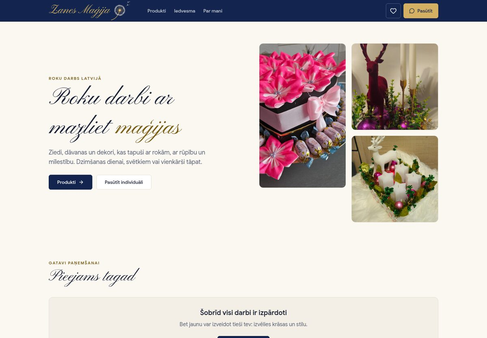
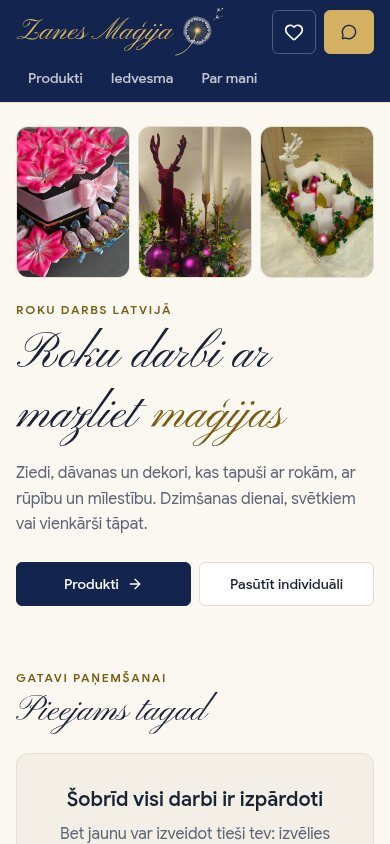
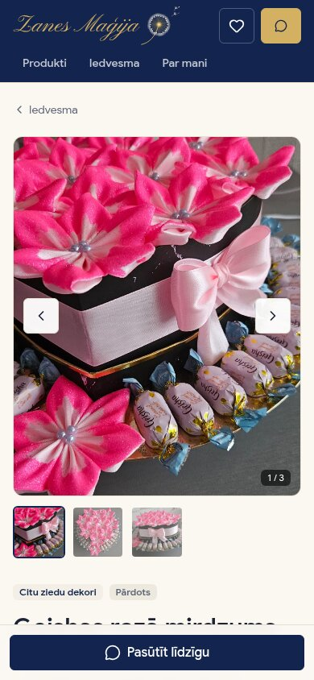

<p align="center">
  
</p>

<h1 align="center">Zanes Maģija</h1>

<p align="center">
  Online shop window for handmade gifts, decor and satin-ribbon bouquets from Latvia: browse what's available,
  get inspired by past work, and order in one tap on WhatsApp.
</p>

<p align="center"><a href="https://zanespuskisi.lv"><b>Open the shop</b></a></p>

<p align="center"></p>

## Features

**For customers**
- Available products with category filters and sorting, plus a gallery of past work ("Iedvesma")
- Product pages with photo gallery, sale (holiday) prices, share button and link previews
- "Order" opens WhatsApp with a ready message that names the product
- Wishlist saved on the device, no account needed; old share links keep working
- No tracking, no ads, no cookies to accept

**For the shop owner** (`/admin`, Google login for three admin accounts)
- Add and edit products, drag-and-drop photos (shrunk to WebP in the browser before upload), reorder, pick the cover
- One tap to mark a piece sold: it moves to the past-work gallery
- Changes show on the public site within a few minutes

## Run it yourself

Needs [Node.js](https://nodejs.org) 22+ and access to the Firebase project.

```bash
cp .env.example .env.local   # fill in WHATSAPP_PHONE
npm install
npm run dev                   # http://localhost:3000
```

## Screenshots

<p align="center">
  
  
</p>

## Deploy

```bash
firebase deploy --only apphosting                 # the website (Firebase App Hosting)
firebase deploy --only firestore:rules,storage    # database and photo rules
```

## Tests

```bash
npm test && npm run lint && npm run build
```

## Built with

Next.js 16 (App Router, Cache Components), React 19, Tailwind CSS 4, Firebase (Firestore, Storage, Auth),
hosted on Firebase App Hosting. Design notes: [DESIGN.md](DESIGN.md).

## License

[MIT](LICENSE). Product photos and texts belong to Zanes Maģija and aren't covered by the license.
